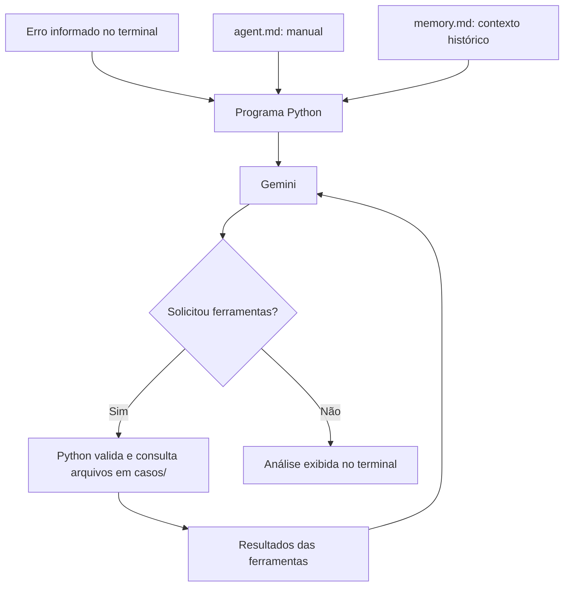

# Agente Debug

Agente de investigação de bugs desenvolvido em Python, com interface pelo terminal e integração com o Gemini. Recebe mensagens de erro, stack traces e contexto do usuário, consulta arquivos Python de uma pasta autorizada e produz uma análise com possíveis causas, sugestões de correção e formas de verificar o resultado.

O projeto foi criado para aprender a construir um agente com código próprio, explorando instruções de sistema, contexto histórico e chamadas de ferramentas (*function calling*).

## Funcionalidades

- Entrada de erros e contexto com várias linhas pelo terminal.
- Manual de investigação separado do código, em `agent.md`.
- Leitura de contexto histórico a partir de `memory.md`.
- Listagem e leitura de arquivos Python na pasta autorizada `casos/`.
- Validação dos nomes das ferramentas, argumentos, caminhos e tamanho dos arquivos.
- Continuidade da investigação entre consultas ao modelo.
- Limites de consultas e de ferramentas por resposta.
- Exibição de falhas da API e de informações de diagnóstico quando disponíveis.

O agente sugere correções. A aplicação das mudanças e a execução dos testes ficam a cargo de quem está investigando o problema.

## Como funciona



1. O programa carrega o manual e a memória e recebe o erro informado pelo usuário.
2. Envia o manual como instrução de sistema e a memória como contexto histórico junto com o erro atual.
3. O Gemini pode responder diretamente ou solicitar uma das ferramentas disponíveis.
4. O Python valida a solicitação, executa a ferramenta e devolve seu resultado ao modelo.
5. O ciclo continua até uma resposta sem novas chamadas de ferramentas ou até um limite de execução.

O modelo solicita as consultas; as funções Python controlam o acesso aos arquivos. O parâmetro `previous_interaction_id` mantém a continuidade entre as consultas de uma mesma investigação.

## Estrutura do projeto

```text
agente-debug/
├── casos/
│   └── calculadora.py   # Exemplo com bug intencional
├── tests/
│   ├── __init__.py
│   ├── test_ferramentas.py  # Arquivos e limites de acesso
│   └── test_main.py         # Fluxo com respostas simuladas
├── .gitignore          # Arquivos locais ignorados pelo Git
├── agent.md            # Manual e regras de investigação
├── ferramentas.py      # Ferramentas e suas descrições para o modelo
├── main.py             # Entrada, integração com Gemini e ciclo do agente
├── memory.md           # Contexto histórico carregado na inicialização
└── README.md
```

| Componente | Responsabilidade |
| --- | --- |
| [main.py](main.py) | Receber a entrada, montar o contexto, consultar a API e coordenar as ferramentas. |
| [ferramentas.py](ferramentas.py) | Implementar as consultas aos arquivos e as validações de acesso. |
| [agent.md](agent.md) | Orientar a investigação, a comunicação dos resultados e o tratamento de evidências. |
| [memory.md](memory.md) | Fornecer histórico e decisões anteriores como contexto, sujeito a informações desatualizadas. |
| [casos/calculadora.py](casos/calculadora.py) | Disponibilizar um caso pequeno para experimentar a investigação. |

### Organização de `main.py`

O programa está dividido em funções com responsabilidades definidas:

| Função | Responsabilidade |
| --- | --- |
| `carregar_contexto()` | Ler o manual e a memória da pasta do projeto. |
| `receber_erro()` | Receber a entrada até `FIM` e recusar conteúdo vazio. |
| `montar_pedido()` | Combinar o erro atual com a memória histórica. |
| `consultar_gemini()` | Consultar a API e apresentar informações de falha. |
| `executar_ferramenta()` | Validar a solicitação e retornar o resultado ou o erro da ferramenta. |
| `investigar()` | Coordenar as consultas ao modelo, as ferramentas e os limites. |
| `main()` | Iniciar o fluxo e garantir o fechamento do cliente da API. |

O bloco `if __name__ == "__main__":` chama `main()` quando o arquivo é executado diretamente. Importar o módulo permite acessar suas funções sem iniciar a entrada pelo terminal nem criar o cliente da API.

## Requisitos

- Python 3.10 ou superior.
- Acesso à internet.
- Chave da API do Gemini e acesso ao modelo configurado.
- Biblioteca `google-genai`.

O ambiente usado no desenvolvimento tem Python 3.15 e `google-genai` 2.31.0. Os comandos abaixo usam essa versão da biblioteca.

## Instalação e execução

Os exemplos a seguir usam **Windows com PowerShell**. Abra o terminal na pasta do projeto depois de baixar ou clonar o repositório.

### 1. Criar o ambiente virtual

```powershell
python -m venv .venv
```

### 2. Instalar a dependência

```powershell
.\.venv\Scripts\python.exe -m pip install "google-genai==2.31.0"
```

Os comandos usam diretamente o Python da `.venv`, sem precisar ativar o ambiente virtual.

### 3. Configurar a chave da API

Crie ou consulte sua chave no [Google AI Studio](https://aistudio.google.com/api-keys). Configure a variável de ambiente na mesma sessão do PowerShell em que executará o agente:

```powershell
$env:GEMINI_API_KEY = "SUA_CHAVE_AQUI"
```

Substitua o texto de exemplo pela sua chave. Essa configuração vale para a sessão atual do terminal. O SDK também reconhece `GOOGLE_API_KEY`; se as duas variáveis estiverem definidas, `GOOGLE_API_KEY` tem prioridade. Consulte a [documentação de chaves do Gemini](https://ai.google.dev/gemini-api/docs/api-key).

O programa atual não carrega arquivos `.env` automaticamente. Criar esse arquivo, por si só, não configura a autenticação.

### 4. Executar o agente

Mantenha `agent.md` e `memory.md` ao lado de `main.py`. Os dois arquivos são obrigatórios na implementação atual.

```powershell
.\.venv\Scripts\python.exe main.py
```

Cole o erro e seu contexto. Quando terminar, digite `FIM` em uma linha separada.

## Exemplo de uso

O arquivo [casos/calculadora.py](casos/calculadora.py) contém este exemplo intencionalmente problemático:

```python
def calcular_media(valores):
    return sum(valores) / len(valores)


print(calcular_media([]))
```

Depois de iniciar o agente, uma entrada possível é:

```text
Ao calcular a média de uma lista vazia, recebo este erro:
ZeroDivisionError: division by zero
O código está em calculadora.py, dentro da pasta casos.
Quero entender a causa e decidir como tratar uma lista vazia.
FIM
```

O agente pode solicitar a leitura do arquivo para apoiar o diagnóstico. Nesse caso, a operação divide por `len(valores)`, que é zero para uma lista vazia. A correção depende do comportamento desejado, como rejeitar a entrada com uma mensagem clara.

Esse exemplo descreve uma investigação possível. A sequência de ferramentas e o texto da análise dependem da resposta do modelo.

## Testes locais

Os testes usam `unittest` e `unittest.mock`, que fazem parte da biblioteca padrão do Python. Instale a dependência do projeto conforme as instruções acima; não é necessário instalar um framework de testes adicional.

Execute na raiz do projeto:

```powershell
.\.venv\Scripts\python.exe -m unittest discover -s tests -v
```

A suíte verifica:

- Leitura em UTF-8, limite de caracteres e listagem dos arquivos autorizados.
- Recusa de caminhos externos, extensões proibidas e arquivos inexistentes.
- Validação dos argumentos e conversão de falhas das ferramentas em resultados.
- Continuidade das consultas e associação dos resultados às chamadas por `call_id`.
- Limites de consultas e de ferramentas por resposta.
- Fechamento do cliente em caso de sucesso ou falha da API.
- Importação de `main.py` sem iniciar o terminal ou criar o cliente da API.

As ferramentas são verificadas com arquivos temporários criados dentro de `tests/` e removidos ao final de cada teste. O cliente do Gemini é simulado e conexões de rede são bloqueadas nos testes do fluxo. Não é necessário configurar uma chave da API nem consumir sua cota para executar a suíte.

O teste de links simbólicos pode ser marcado como ignorado (`skipped`) quando o sistema não permitir sua criação. Os testes verificam o comportamento local do programa; não avaliam a qualidade dos diagnósticos nem a disponibilidade do Gemini.

## Ferramentas e limites

| Ferramenta | Argumentos | Comportamento |
| --- | --- | --- |
| `listar_arquivos` | Nenhum | Retorna os nomes dos arquivos `.py` diretamente em `casos/`, em ordem alfabética. |
| `ler_arquivo` | `caminho`: texto | Lê um arquivo `.py` em UTF-8, com caminho relativo a `casos/` e até 20.000 caracteres. |

- A listagem não percorre subpastas. A leitura aceita arquivos em subpastas desde que permaneçam dentro da pasta autorizada.
- Caminhos resolvidos para fora de `casos/` são recusados.
- O programa faz até cinco consultas ao modelo por investigação, conforme `MAX_RODADAS` em `main.py`.
- Cada resposta pode solicitar até cinco ferramentas. Acima disso, a investigação é interrompida antes de executar o lote.
- As ferramentas são executadas nas primeiras quatro respostas. Se a quinta ainda pedir ferramentas, o programa informa que a investigação está incompleta. Isso permite até 20 execuções de ferramentas por investigação.
- Essas contagens se referem ao ciclo do programa. Repetições internas do SDK podem gerar tentativas HTTP adicionais.

O modelo configurado atualmente é `gemini-3.6-flash`, definido na constante `MODELO` em `main.py`. A disponibilidade do modelo e as cotas dependem da conta e do serviço. O projeto não configura faturamento nem troca de modelo automaticamente.

## Memória e cuidados com os dados

`memory.md` é um arquivo de contexto editado manualmente. O programa lê seu conteúdo inteiro no início e o envia ao Gemini junto com o erro atual. Não há gravação automática de aprendizados nem ferramenta `registrar_memoria` implementada nesta versão.

O manual, o erro informado e os resultados das ferramentas também são enviados à API durante a investigação. Revise o material antes de usar código ou dados de outros projetos.

- Guarde a chave da API fora do código e do repositório.
- Mantenha `.venv/`, `__pycache__/` e arquivos `.env` fora do Git, conforme o `.gitignore`.
- Revise a memória antes de publicá-la: ela pode conter caminhos locais, histórico pessoal ou informações de projetos.
- Use arquivos de exemplo em `casos/` que possam ser compartilhados com a API e, se publicados, com quem acessar o repositório.

## Próximas melhorias

- [x] Organizar `main.py` em funções e adicionar um ponto de entrada explícito.
- [ ] Separar a interface de terminal, o cliente da API e o ciclo de investigação.
- [ ] Tornar a memória opcional na inicialização e selecionar apenas o contexto relevante.
- [ ] Configurar explicitamente os tempos limite e a política de repetição do SDK.
- [x] Adicionar testes locais das ferramentas e do ciclo com respostas simuladas.
- [ ] Implementar o registro validado de memória, preservando evidências e registros anteriores.
